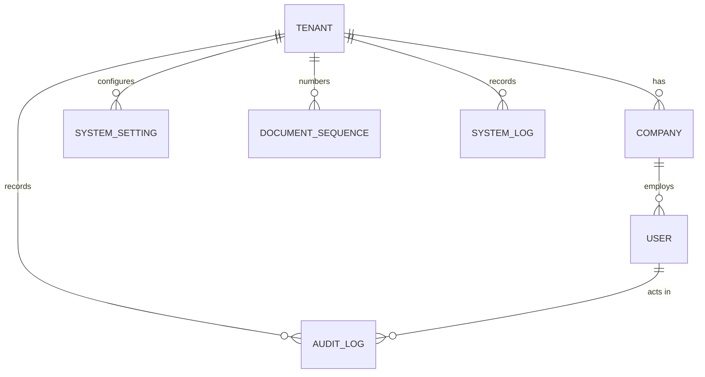

# Checkpoint 1 — Core / Settings: Plan (Gate A)

> Status: **approved 2026-09-29 (D1–D8 as recommended) and implemented**. See [CP1_CORE_SETTINGS_STATUS.md](CP1_CORE_SETTINGS_STATUS.md).
> Builds on: [CP0_FOUNDATION_STATUS.md](CP0_FOUNDATION_STATUS.md) · Program: [../erp-ui-program/PLAN.md](../erp-ui-program/PLAN.md)
> Written: 2026-09-29

## 0. Why this checkpoint changed shape

Core/Settings looked like "tidy up some admin screens". The code review found platform problems that every later module depends on, so they come first:

| # | Finding | Severity |
|---|---------|----------|
| F1 | **Cross-tenant data leak.** `SystemSettingService`, `AuditLogService` and `SystemLogService` accept a `tenantId` and ignore it. Any signed-in user of any tenant can read, and for settings **edit or delete**, every tenant's settings, audit log and system log. | Critical |
| F2 | **Tenant administration is open to every signed-in user.** REST `/api/tenants` and GraphQL `AddTenant`/`UpdateTenant`/`DeleteTenant` only require authentication. GraphQL `GetAuditLogsByTenant(tenantId)` reads any tenant's audit log by a caller-supplied id. | Critical |
| F3 | **Audit and system logs can be forged or erased.** `POST /audit-logs`, `POST /audit-logs/log-action`, and `PUT`/`DELETE /system-logs` are open to any signed-in user. | High |
| F4 | **Nothing writes the audit log or the system log automatically**, so the log screens are empty by construction, and so is every future "History" tab. | High |
| F5 | **"Encrypted" settings are stored and returned in plain text.** `IsReadOnly` is not enforced. | High |
| F6 | **Navigation is broken for most modules.** 7 of 9 tiles on `/modules` link to routes that don't exist (404). The sidebar only has menus for legacy `/erp` admin and CRM; HRM, Finance, Inventory, Procurement, Manufacturing, Projects and POS have none. | High (usability) |
| F7 | **There's no Company API.** The `Company` entity (name, legal name, address, **currency, time zone**) and its repository exist, but there's no service or endpoint, so the tenant's own profile can't be viewed or changed. | Medium |
| F8 | **Settings are a free-form key/value table** with no seeded catalog, so the settings page is empty and nothing reads it. | Medium |
| F9 | **Document numbers are random** (`QT-20260929-3F2A1B9C`, from a truncated GUID) instead of per-tenant sequences such as `QT-2026-00042`. | Medium |
| F10 | **Duplicate admin screens** (`pages/erp/*` vs `modules/core/*`) and a sidebar that points at the legacy copies. | Low |

F1–F3 are fixed with **explicit tenant scoping and a SuperAdmin role check**. Checkpoint 2 then replaces the role check with the full permission system.

---

## 1. Decisions needed

| # | Decision | Options | Recommendation |
|---|----------|---------|----------------|
| D1 | Who manages tenants | (a) SuperAdmin only, as a platform area. (b) Also allow a tenant's own admin to edit its tenant record. | **(a).** A tenant's own admin edits the **Company profile** (D2), not the tenant record. |
| D2 | Where "General settings" (company name, logo, address, currency, time zone) live | (a) Typed **Company profile** on the existing `Company` entity, via a new `GET/PUT /api/core/company`. (b) Key/value settings. | **(a).** The fields already exist on `Company`, and typed data validates properly. |
| D3 | Settings model | (a) A **settings catalog defined in code** (key, type, default, validation, category, sensitive flag) stored in the existing `SystemSettings` table and shown as grouped forms. Free-form key editing is only kept as a SuperAdmin "advanced" list. (b) Keep free-form key/value CRUD as the main UI. | **(a).** |
| D4 | Encrypted settings | (a) Real encryption with ASP.NET Data Protection. Values are **write-only** in the API and UI (shown as "Set" / "Not set", replaceable, never returned). (b) Keep the cosmetic flag. | **(a).** |
| D5 | Automatic audit | (a) An EF **`SaveChanges` interceptor** writes an `AuditLog` row for every create, update and delete of tenant data, with the user, tenant, and changed fields (before/after). Secrets are redacted: password hashes, salts, tokens, encrypted settings. (b) Keep opt-in auditing. | **(a).** This also turns on History for Customers and every later module. |
| D6 | Numbering sequences | (a) Build a per-tenant `DocumentSequence` table (new EF migration) with an atomic next-number operation and a settings screen, and switch CRM quote/order/lead/opportunity numbers to it. (b) Defer to Finance (Checkpoint 6). | **(a).** Numbering is Core infrastructure, and Finance needs it anyway. Existing random numbers stay as they are. |
| D7 | Legacy `/erp/*` admin pages | (a) Delete them and redirect each old URL to its `/core/settings/*` equivalent. (b) Keep both. | **(a).** |
| D8 | Tenant list on the sign-in page (`/api/tenants/login-options` is anonymous and lists every tenant's name and domain) | (a) Decide in Checkpoint 2 (authentication). (b) Change it now. | **(a).** It's a sign-in UX choice; I'll note the enumeration risk in the status doc. |

---

## 2. Scope

### In
- **Tenant isolation and lockdown (F1–F3, F5):** tenant-scoped settings, audit logs and system logs; SuperAdmin-only tenant administration (REST and GraphQL); read-only logs; real encryption for sensitive settings; enforced read-only settings.
- **Automatic audit (F4)** and **error logging:** unhandled 5xx errors and security events (sign-in failures, lockouts) written to `SystemLog`, tenant-scoped.
- **Company profile (F7)**, with the tenant currency, locale and time zone feeding `setFormatDefaults` so the whole UI formats money and dates correctly.
- **Settings catalog and grouped settings pages (F8).**
- **Numbering sequences (F9).**
- **Platform navigation (F6):** one module registry that drives the `/modules` tiles and every module's sidebar. Each module gets a landing page at `/<module>` listing its areas, with no invented numbers, until its own dashboard checkpoint.
- **Audit log and system log explorers** with server paging and filters, plus a before/after diff view.
- **Core dashboard ("System health")** built from real data.
- **Removal of the `pages/erp/*` duplicates**, with redirects (F10).

### Out (owned elsewhere)
| Item | Owner |
|------|-------|
| Users, roles and permission enforcement | Checkpoint 2 (Admin + RBAC) |
| Departments (HRM entity, currently a stub) | Checkpoint 7 |
| Cost centers (Finance entity, no API yet) | Checkpoint 6 |
| Currencies, tax rates, units of measure | Owned by Finance/Inventory. Their existing screens are linked from a **Reference data** hub, not duplicated. |
| Branches/locations | No entity exists. Warehouses cover inventory locations. Revisit if a module needs branches. |
| File uploads (company logo file, file storage settings) | No storage service exists. The logo is a URL field for now. |
| Email/SMTP sending | No email service exists. The settings catalog defines the keys (sensitive password included) but nothing sends mail yet. The page says so. |

---

## 3. Entities and relationships

| Entity | Kind | Status |
|--------|------|--------|
| Tenant | Platform master (SuperAdmin) | Exists. Lock down. |
| Company | Tenant master (profile) | Entity and repository exist. **Add service + API.** |
| SystemSetting | Tenant configuration | Exists. **Scope + catalog + encryption.** |
| DocumentSequence | Tenant configuration | **New:** tenant, key (e.g. `crm.quote`), prefix, next number, padding, reset policy (never/yearly), last reset year, row version. |
| AuditLog | Historical, append-only | Exists. **Scope, make read-only over the API, write automatically.** |
| SystemLog | Historical, append-only | Exists. **Scope, make read-only, write 5xx and security events.** |
| `Core/Setting` (second settings entity, used only via `Tenant.Settings`) | Duplicate | Leave untouched. Record it for Checkpoint 12 consolidation. |

---

## 4. Pages and routes

| Route | Page | Notes |
|-------|------|-------|
| `/core` | **Core dashboard** (System health) | New. See §5. |
| `/core/settings` | Settings hub | Rebuilt: cards for Company, Preferences, Numbering, Security, Email, Reference data, Audit log, System log (and Tenants for SuperAdmin). |
| `/core/settings/company` | Company profile (view + edit form) | New |
| `/core/settings/preferences` | Localization and formats (date format, locale, first day of week, time zone override) | New, from the catalog |
| `/core/settings/security` | Session timeout, password policy, lockout thresholds | New, from the catalog. Values are **stored now and enforced by Checkpoint 2** (the page says so). |
| `/core/settings/email` | SMTP host, port, user, password (sensitive), from-address | New, from the catalog. "Sending not available yet" note. |
| `/core/settings/numbering` | Document sequences list + edit drawer (prefix, next number, padding, yearly reset, preview `QT-2026-00042`) | New |
| `/core/settings/reference-data` | Hub linking to Currencies, Units of measure (existing pages); others marked with their owning checkpoint | New |
| `/core/settings/audit-logs` (+ `/:id`) | Audit explorer: server paging; filters for date range, user, entity, action; row opens a before/after diff drawer | Rebuilt |
| `/core/settings/system-logs` (+ `/:id`) | System log explorer: paging; filters for level, date range, source; detail drawer with the trace id | Rebuilt |
| `/core/settings/tenants` … | Tenant list/form, SuperAdmin only | Moved to the kit. Others get the access-denied page. |
| `/core/settings/system-settings` | "Advanced settings" raw key list, SuperAdmin only | Kept, on the kit |
| `/<module>` for every module | Module landing page | New (from the registry) |
| `/erp/*` (17 URLs) | Redirects to `/core/settings/*` | Legacy pages deleted |

Users/roles pages stay where they are for Checkpoint 2.

---

## 5. Core dashboard widgets

Every widget uses a real query. No sample numbers.

| Widget | Source | Status |
|--------|--------|--------|
| Active users (signed in within 7 days) / total users | `Users.LastLoginAt` | REAL |
| Locked accounts / failed sign-ins (24h) | `Users.IsLocked`, `LockedUntil`; SystemLog security events (new) | REAL (the failed sign-in count starts at zero when this ships) |
| Errors in the last 24h (by level) + latest 5 | `SystemLog` | REAL once WP2 writes 5xx errors |
| Recent configuration changes | `AuditLog` where entity is SystemSetting, Company or DocumentSequence | REAL once WP2 audits |
| Setup checklist: company profile complete, currency and time zone set, numbering configured, email configured | Company + settings + sequences | REAL |
| Tenants (SuperAdmin only) | `Tenants` count by status | REAL |

Backend: `GET /api/core/dashboard/summary`, tenant-scoped, with a SuperAdmin-only section. Each widget is isolated, so one failing doesn't blank the page.

---

## 6. Navigation

- **One module registry** (`frontend/src/modules/registry.ts`): id, name, description, icon, landing route, sidebar sections and entries, and the permission code for each entry.
- `/modules` tiles, the sidebar (`constants/menu.ts` becomes generated), and the `/<module>` landing pages all read from it, so a link to a missing route can't be added without the route test failing.
- The sidebar filters entries with `usePermission`, which is permissive until Checkpoint 2.
- Landing pages list the module's areas with short descriptions. The KPI area says "Dashboard arrives in Checkpoint N" instead of showing numbers.

---

## 7. Permission codes (catalog now, enforced in Checkpoint 2)

`core.dashboard.view` · `core.company.view` · `core.company.update` · `core.settings.view` · `core.settings.manage` · `core.sequences.manage` · `core.audit.view` · `core.logs.view` · `core.tenants.manage` (SuperAdmin)

For now the backend enforces two things: **tenant scoping everywhere**, and **SuperAdmin-only** tenant administration, cross-tenant views and advanced settings.

---

## 8. API work

| Endpoint | Change |
|----------|--------|
| `/api/admin/system-settings/*` | Tenant-scoped; honors read-only; encrypts sensitive values; GET never returns sensitive values (`hasValue: true`) |
| `GET /api/core/settings/{category}` · `PUT /api/core/settings/{category}` | **New.** Typed catalog read and write, validated against the catalog |
| `GET/PUT /api/core/company` | **New.** The caller's company |
| `GET /api/core/sequences` · `PUT /api/core/sequences/{key}` · `GET .../{key}/preview` | **New** |
| `GET /api/admin/audit-logs/paged` | **New.** Tenant-scoped, with filters. Remove `POST /` and `POST /log-action` (writes are server-side only). |
| `GET /api/admin/system-logs/paged` | **New.** Remove `POST`, `PUT` and `DELETE`. |
| `/api/tenants` (except anonymous login-options and domain lookup) | SuperAdmin only |
| GraphQL `CoreQuery`/`CoreMutation`/`AdminQueries` tenant and log fields | SuperAdmin only, or tenant-scoped with the caller-supplied `tenantId` removed |
| `GET /api/core/dashboard/summary` | **New** |

## 9. Workflows

None needing approval in this module. Changes to settings, company and sequences are audited automatically (D5).

## 10. Work packages and order

| WP | Content | Depends on |
|----|---------|------------|
| WP1 | **Tenant isolation and lockdown:** scoping in the settings/audit/system-log repositories and services; SuperAdmin guard on tenants (REST + GraphQL); remove the log write/edit/delete endpoints; tests proving tenant A can't read or change tenant B's data | — |
| WP2 | **Automatic audit interceptor** (redaction list, before/after diff, user + tenant from context) and **SystemLog writer** for 5xx and security events; tests | WP1 |
| WP3 | **Settings catalog, encryption, read-only enforcement, typed settings API**; tests | WP1 |
| WP4 | **Company service + API**; tenant format defaults loaded after sign-in → `setFormatDefaults` | WP1 |
| WP5 | **Numbering sequences:** entity, migration, atomic `NextAsync` (concurrency-tested), API; CRM generators switched over | WP1 |
| WP6 | **Navigation:** module registry, generated sidebar, fixed `/modules` tiles, `/<module>` landing pages, route test for every registry link | — |
| WP7 | **Frontend pages:** settings hub, company, preferences, security, email, numbering, reference-data hub, audit and system log explorers, tenants and advanced settings on the kit | WP3–WP6 |
| WP8 | **Core dashboard** (endpoint + page) | WP2, WP7 |
| WP9 | **Legacy cleanup:** delete `pages/erp/*`, add `/erp/*` redirects, delete the unused `services/erp/*` duplicates | WP7 |
| WP10 | Tests, docs, status doc | all |

## 11. Exit criteria (Gate B)

- [ ] ERP.Tests prove that as tenant A **you cannot** read or change tenant B's settings, audit logs or system logs (REST and GraphQL), and that a non-SuperAdmin gets 403 on tenant administration.
- [ ] Creating, updating and deleting a customer produces audit entries with field-level before/after values. A user's password hash never appears in any audit entry (test). The customer History tab shows real entries.
- [ ] A sensitive setting is stored encrypted (checked in the database), never returned by the API, and replaceable. Read-only settings reject updates (409).
- [ ] 50 concurrent `NextAsync("crm.quote")` calls return 50 distinct, consecutive numbers (test). New CRM quotes get `QT-2026-00001`-style numbers.
- [ ] Changing the company currency and locale changes how money and dates format across the app after the next sign-in.
- [ ] Every `/modules` tile and every sidebar entry resolves to a real page (route test). Each module shows a sidebar.
- [ ] Audit and system log explorers page and filter on the server, and a row shows its before/after diff.
- [ ] The Core dashboard shows only real figures. Stopping one widget's query shows that widget's error state only.
- [ ] All `/erp/*` URLs redirect. `pages/erp` is gone.
- [ ] Build, lint (0 errors), vitest and dotnet test all pass. Status doc written.

## 12. Risks

| Risk | Mitigation |
|------|------------|
| The audit interceptor slows writes or floods the table | Only changed fields are stored; secrets are redacted; bulk system tables are excluded; an index on (TenantId, EntityName, EntityId, Timestamp); measured in tests with 1,000 inserts |
| Tenant scoping breaks something that relied on the leak (e.g. SuperAdmin cross-tenant views) | SuperAdmin keeps an explicit `?allTenants=true` on the log explorers; covered by tests |
| New migration against your SQL Server alongside the SQL-script deploy path | A single additive migration (new table + index); reviewed before running; rollback script included |
| The Data Protection key ring must persist, or encrypted settings become unreadable after a restart | Keys persisted to a folder configured in appsettings, which the status doc tells you to back up. Losing it means re-entering those secrets, not losing data. |
