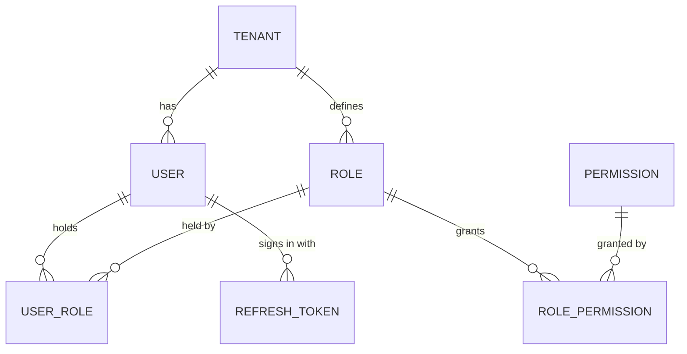

# Checkpoint 2 — Admin and Platform RBAC: Plan (Gate A)

> Status: **awaiting approval**. No code has been changed for this checkpoint.
> Builds on: [CP1_CORE_SETTINGS_STATUS.md](CP1_CORE_SETTINGS_STATUS.md) · Program: [../erp-ui-program/PLAN.md](../erp-ui-program/PLAN.md)
> Written: 2026-10-01

This is the security milestone. When it's done, **every API endpoint checks a permission**, every screen shows only what the user may use, and administrators can manage users and roles properly.

## 0. What the review found

| # | Finding | Severity |
|---|---------|----------|
| F1 | **Cross-tenant user management.** Users are read and written through stored procedures. `sp_GetAllUsers` and `sp_GetUserById` have no tenant filter, and update/delete pass the *target* user's tenant, not the caller's. Any signed-in user can list every tenant's users and edit, delete or reset the password of users in other organizations. Because this path is Dapper, it also **bypasses the Checkpoint 1 tenant guard and audit trail**. | Critical |
| F2 | **No permission is enforced anywhere.** Every endpoint only requires a signed-in user. The permission catalog covers Core only (17 codes) and is **empty in your database** (seed never run); no role has any permission. | Critical |
| F3 | **Users can't be given roles after creation.** Roles can only be set when creating a user; there's no assign/unassign endpoint or screen. | High |
| F4 | **Refresh tokens are stored in plain text**, one per user (a new sign-in silently ends the previous session). | High |
| F5 | **The app never refreshes tokens.** After 60 minutes users are logged out mid-work. | Medium (usability) |
| F6 | **Security settings saved in Checkpoint 1 aren't enforced.** Password minimum is hard-coded to 6 (the catalog's minimum is 8), lockout is hard-coded to 5 attempts / 30 minutes, and session length is hard-coded. | Medium |
| F7 | **The sign-in page lists every tenant to anonymous visitors** (`/api/tenants/login-options`): decision D8, deferred from Checkpoint 1. | Medium |
| F8 | **A "Register" link on the sign-in page** leads to a template page; there's no self-registration API. | Low |
| F9 | Your database has 2 users. One is SuperAdmin. **The other has no role**, so once permissions are enforced it will see nothing until it's given a role. | Rollout risk |

---

## 1. Decisions needed

| # | Decision | Options | Recommendation |
|---|----------|---------|----------------|
| D1 | How endpoints declare permissions | (a) **By convention:** each controller declares its resource (e.g. `crm.customers`); the HTTP method gives the action (GET→view, POST→create, PUT/PATCH→update, DELETE→delete). Workflow actions declare their own code (e.g. `crm.leads.convert`). One global filter enforces it, and a test fails if any controller lacks a declaration. (b) An explicit attribute on every action (~600 attributes). | **(a).** Less boilerplate and impossible to forget, because the test fails. |
| D2 | Permission catalog source | (a) **Generated from the controller declarations** plus a small list of extra actions, so the catalog always matches what's enforced. (b) A hand-maintained list. | **(a)** |
| D3 | Built-in roles per tenant | (a) Seed a small set of **system roles**: *Administrator* (everything in the tenant), *Read-only* (all `view`), plus editable templates *Sales*, *Finance*, *HR*, *Operations*. SuperAdmin stays the platform role. (b) Only Administrator. | **(a).** Tenants can copy and edit the templates; system roles can't be deleted. |
| D4 | User storage | (a) **Move user reads and writes to EF Core** (tenant-scoped base, tenant guard, audit trail). The stored procedures stay in the database, unused. (b) Patch each stored procedure to take the caller's tenant. | **(a).** One data path, guarded and audited like the rest. |
| D5 | Your second user (no role today) | (a) Give them *Administrator* during rollout. (b) Give them *Read-only*. (c) Leave them without a role. | **Your call.** I'll default to (b) *Read-only* unless you say otherwise. |
| D6 | Sign-in tenant selection (F7) | (a) **"Organization" field:** the user types their organization's domain (e.g. `newdomain.com`), resolved with the existing anonymous lookup. No list is shown. If the installation has exactly one tenant, it's pre-selected and the field is hidden. (b) Keep the dropdown. | **(a)** |
| D7 | Sessions | (a) **Silent refresh:** the app refreshes the access token before it expires. Refresh tokens are **hashed** and stored per session (several devices allowed), rotated on each use, and reuse of an old token revokes that session. Session length comes from the tenant's security settings. (b) Keep the current behavior. | **(a).** This needs a migration: a new `RefreshTokens` table, reviewed before it runs, like Checkpoint 1. |

---

## 2. Scope

### In
1. **User management:** an EF tenant-scoped repository; full user lifecycle (create with roles, edit, assign/unassign roles, activate/deactivate, unlock, reset password, sign out everywhere); the user detail shows roles, effective permissions, sign-in history and audit.
2. **Roles:** CRUD with system-role protection, a **permission matrix** (rows = module › resource, columns = view/create/update/delete/export/approve/…), copy a role, members list.
3. **Permission enforcement:** the convention filter; the generated catalog for all modules; effective permissions cached per user and invalidated when roles change; SuperAdmin bypass; 403 with a clear message.
4. **Session:** effective permissions in the login response and `GET /api/auth/me`; frontend `usePermission` switches to strict mode automatically. Silent refresh. Hashed rotating refresh tokens.
5. **Security settings enforced:** password minimum length (create, reset, change), lockout threshold and duration, session timeout. Successful sign-ins are logged too, for the sign-in history.
6. **Sign-in page:** organization field (D6); remove the Register link.
7. **Admin dashboard** (`/admin`): users (active/inactive/locked), roles, users without a role, recent permission changes, sign-ins over 7 days.
8. **Rollout:** a seed on startup per tenant: catalog + system roles; existing SuperAdmin unchanged; second user per D5.
9. Move the **Tenants** and **Advanced settings** screens onto the kit (carried over from Checkpoint 1).

### Out
- Field-level permissions (e.g. hiding salary fields): handled per module (HRM, Checkpoint 7) using the same codes.
- Single sign-on (SSO), multi-factor authentication (MFA) and email delivery of password resets (no email service yet).
- Per-record permissions (e.g. "only my own leads"): may come later per module.

---

## 3. Entities and relationships

| Entity | Status |
|--------|--------|
| User, Role, Permission, RolePermission, UserRole | Exist. Users move to EF (D4); Role gains an `IsSystemRole` guard (column exists) |
| RefreshToken | **New:** tenant, user, token **hash**, created/expires, replaced-by, revoked-at/reason, IP, user agent |
| UserSession (exists, unused) | Left as is; superseded by RefreshToken (noted for Checkpoint 12) |

## 4. Pages and routes

| Route | Page |
|-------|------|
| `/admin` | Admin dashboard (new). The Admin module home moves here from the Users list. |
| `/admin/users` · `/new` · `/:id` · `/:id/edit` | Users list (server-paged), form with role picker, detail with tabs: Overview, Roles & access, Sign-in history, Activity |
| `/admin/roles` · `/new` · `/:id` · `/:id/edit` | Roles list, form, detail with tabs: Permissions (matrix), Members, Activity |
| `/core/settings/users/*`, `/core/settings/roles/*` | Redirect to `/admin/*` |
| `/core/settings/tenants/*`, `/core/settings/system-settings/*` | Rebuilt on the kit (SuperAdmin) |
| `/auth/login` | Organization field (D6), no Register link |

## 5. Permission codes

Generated per controller resource. Examples:
- `admin.users.view|create|update|delete`, `admin.users.resetPassword`, `admin.users.unlock`
- `admin.roles.view|create|update|delete`, `admin.roles.assign`
- `crm.customers.view|create|update|delete`, `crm.leads.convert`, `crm.quotes.send`, `crm.salesOrders.approve`
- `finance.journals.post`, `hrm.leave.approve`, `hrm.payroll.view`, `inventory.transfers.complete`, …
- `core.*` from Checkpoint 1 are kept, with `core.users.*`/`core.roles.*` renamed to `admin.*` by a data migration in the seed.

The frontend registry and route `permission` values (already set in Checkpoint 1) are reconciled to the generated codes by a test that fails on any unknown code.

## 6. API work

| Endpoint | Change |
|----------|--------|
| All controllers | Resource declaration; global permission filter |
| `GET /api/auth/me` | **New:** user, roles, effective permissions, tenant context |
| `POST /api/auth/login`, `/refresh` | Return permissions; hashed rotating refresh tokens; settings-driven lockout and session length; success and failure sign-in events |
| `/api/admin/users` | EF-backed; `GET /paged`; `PUT /{id}/roles`; `POST /{id}/unlock`; `POST /{id}/sign-out-everywhere`; `GET /{id}/sign-ins` |
| `/api/admin/roles` | `GET /paged`; `PUT /{id}/permissions` (replace set, audited); `POST /{id}/copy`; system roles protected (409) |
| `GET /api/admin/permissions/catalog` | Grouped catalog for the matrix |
| `GET /api/admin/dashboard/summary` | **New** |
| `GET /api/tenants/login-options` | Removed in favor of the existing domain lookup (D6) |

## 7. Work packages

| WP | Content |
|----|---------|
| WP1 | **Users on EF** with tenant scoping; F1 fixed with cross-tenant tests |
| WP2 | **Permission model:** resource declarations on all controllers, generated catalog, effective-permission service + cache, global filter, reflection test (every controller declared) |
| WP3 | **Seed and rollout:** catalog + system roles per tenant on startup, idempotent; D5 applied; tests |
| WP4 | **Auth:** `/auth/me`, permissions in session, hashed rotating refresh tokens (migration), settings-driven password, lockout and session rules, sign-in history events |
| WP5 | **Users and roles API:** role assignment, unlock, sign out everywhere, permission matrix, copy, protection rules |
| WP6 | **Frontend auth:** silent refresh, strict permissions, organization field, 403 handling verified |
| WP7 | **Admin UI:** dashboard, users (list/form/detail), roles (list/form/detail + matrix), tenants and advanced settings on the kit, redirects |
| WP8 | Tests, live walk-through on the running app, docs, status |

## 8. Exit criteria (Gate B)

- [ ] As tenant A, a user can't list, read, edit, delete, unlock or reset a user of tenant B (tests over REST).
- [ ] Every controller action requires a permission, or is explicitly anonymous with a reason (reflection test). A role with only `crm.customers.view` can list customers, gets 403 on create, and sees only CRM › Customers in the sidebar.
- [ ] Removing a permission from a role takes effect within a minute without signing out (cache invalidation tested).
- [ ] Refresh tokens are stored hashed; a reused (old) refresh token is rejected and ends that session (tests). The app stays signed in past 60 minutes of activity.
- [ ] Password minimum, lockout threshold/duration and session length follow the tenant's Security settings (tests).
- [ ] The sign-in page doesn't list tenants. Single-tenant installations need no organization input.
- [ ] Permission and role changes appear in the audit log with before/after values.
- [ ] Build, lint (0 errors), vitest and dotnet test pass. **Walk-through done on the running app** (I'll ask you for a test login for this).

## 9. Risks

| Risk | Mitigation |
|------|------------|
| Enforcement locks people out | SuperAdmin bypass; seeded Administrator role; D5 for the existing user; a reflection test that every controller has a resource; a startup log line listing anyone with no role |
| A wrong convention mapping (e.g. a POST that's really a read) | Explicit overrides for non-CRUD actions; test listing every endpoint → code, reviewed in the status doc |
| Permission lookups slow down requests | Per-user cache (60s TTL) with explicit invalidation on role/permission change |
| Migration for refresh tokens | Additive only (new table); reviewed before running, as in Checkpoint 1 |
| Silent refresh bugs cause logouts | Single-flight refresh with retry of the original request; tests with fake timers |
